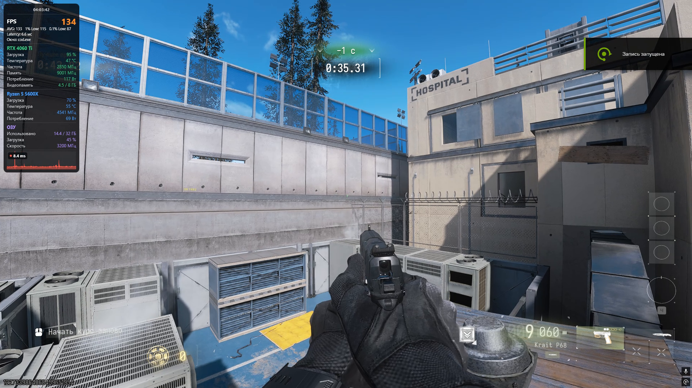
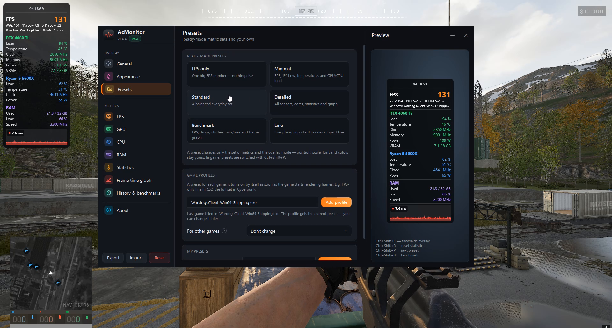
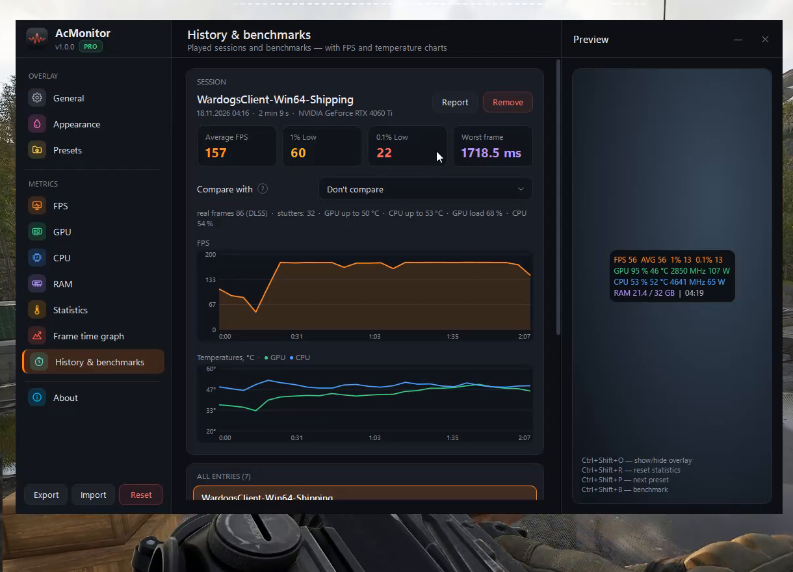

# AcMonitor

**FPS and PC sensors right on top of your game**

AcMonitor shows FPS, 1% Low, GPU and CPU load and temperatures in real time.  
It injects nothing into the game, so anti-cheats have nothing to react to.

Free. Windows 10 and 11. English and Russian interface.

---

## Screenshots

### Overlay on top of a game

### Presets

### History & benchmarks

---

## What the overlay shows

| Section | Data |
|---------|------|
| **FPS** | Current, average, 1% and 0.1% Low, Reflex latency. With DLSS, FSR and XeSS frame generation — how many frames are real |
| **Graphics card** | Load, core and memory temperature, clocks, power, fans, video memory |
| **Processor** | Load, temperature including per-CCD, clocks and power |
| **Memory** | How much is used, speed, DIMM temperatures |
| **Frame graph** | Every frame's time and a stutter detector |

### Also
- One-key benchmark for 30, 60 or 120 seconds with a smoothness score
- Session history with FPS and temperature graphs, run comparison
- FPS color by thresholds and blinking on overheat
- Ready presets, a compact single-line mode, hotkeys
- One-click updates right from the app

---

## Stays out of the game

FPS is counted from Windows events (**ETW**), sensors are read through **LibreHardwareMonitor**.  
AcMonitor doesn't inject code into the game or touch its memory — the overlay is simply drawn on top of the window.

---

## Free vs Pro

| Feature | Free | Pro |
|---------|------|-----|
| All sensors, graphs and stats | ✅ | ✅ |
| Benchmark and the last 5 sessions in history | ✅ | ✅ |
| Ready presets and single-line mode | ✅ | ✅ |
| All overlay colors | ❌ | ✅ |
| Font choice | ❌ | ✅ |
| Your own presets | ❌ | ✅ |
| Per-game profiles | ❌ | ✅ |
| Your own hotkeys | ❌ | ✅ |
| Hide the overlay from recordings and streams | ❌ | ✅ |
| Full history, no limits | ❌ | ✅ |
| Two runs compared on one graph | ❌ | ✅ |
| txt reports and csv tables for Excel | ❌ | ✅ |

---

## System requirements

- **OS:** Windows 10 / 11 (64-bit)
- **Rights:** Administrator (required to read sensors)
- **Graphics:** NVIDIA, AMD and Intel
- **Processors:** Intel and AMD
- **.NET:** No need to install, it's built in
- **Internet:** Only for Pro sign-in and updates

---

## Getting started

1. Download the latest version from [Releases](https://github.com/Accapura/AcMonitor/releases) or from the [website](https://acmonitorpro.ru/)
2. Run the installer (administrator rights required)
3. Start your game — the overlay appears on top
4. Want Pro? In the app: **About → Sign in with Telegram**

---

## FAQ

**The overlay isn't visible in the game**  
1. Make sure the overlay is on (hotkey or tray menu).  
2. Switch the game to **Borderless** mode.  
3. Restart AcMonitor.

**Will an anti-cheat ban me?**  
AcMonitor injects nothing into the game. Data comes from Windows and PC sensors. Anti-cheats don't react to this.

**How to move Pro to another PC?**  
Pro is tied to your Telegram account (up to 3 PCs). On the new PC: AcMonitor → «About» → «Sign in with Telegram».

---

## Links

- 🌐 Website: [acmonitorpro.ru](https://acmonitorpro.ru/)
- 💬 Support and Pro purchase: [@AcMonitorProBot](https://t.me/AcMonitorProBot)
- 📥 Download: [Releases](https://github.com/Accapura/AcMonitor/releases)

---

Made with ❤️ for those who want to see real performance without the risk of a ban.
