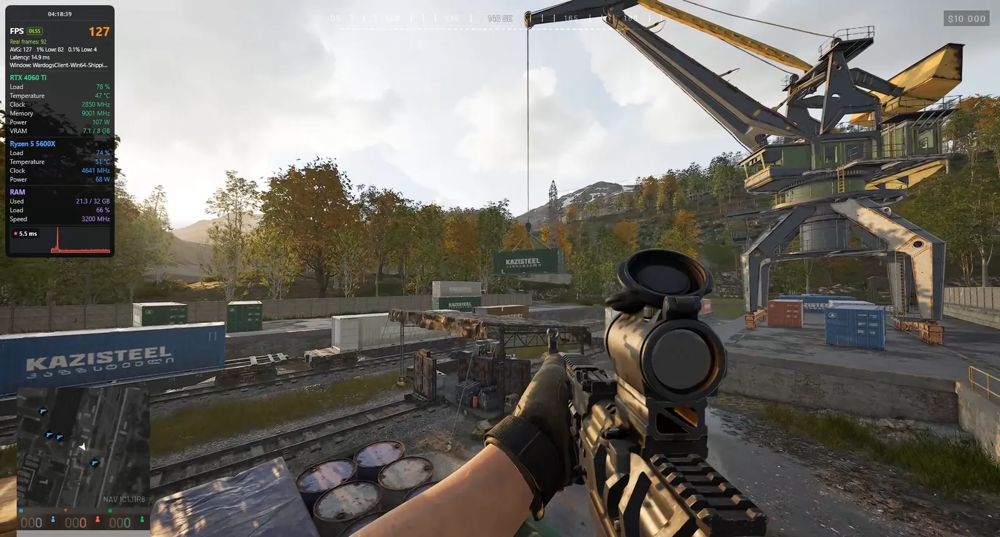
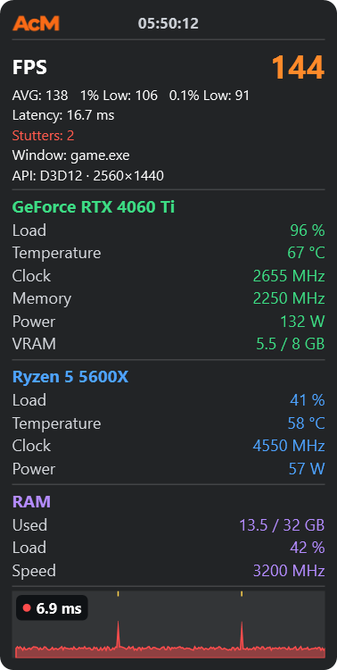
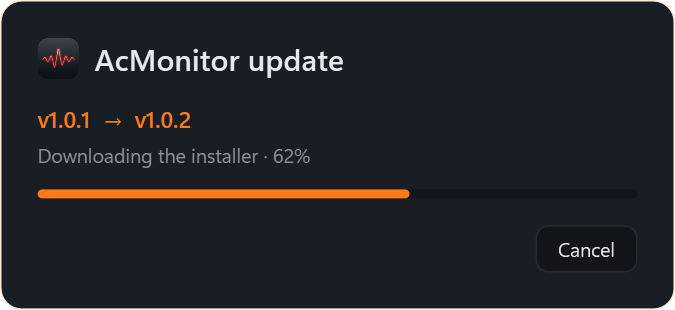

  
  <h1>AcMonitor</h1>
  
<strong>In-game overlay for Windows</strong> Real-time FPS, frame pacing, and PC sensor readings

  

    
    &nbsp;
    
    &nbsp;
    
  

  
Windows 10 / 11 · x64 &nbsp;|&nbsp; <a href="README.md">Русский</a> · <strong>English</strong>

## What AcMonitor shows

| Area | Metrics and tools |
| --- | --- |
| **FPS and frame pacing** | Current and average FPS, 1% and 0.1% lows, a frametime chart, and stutter tracking. |
| **PC sensors** | Utilization, temperatures, clocks, power, RAM, and VRAM. Available readings depend on your hardware. |
| **Overlay** | Standard and compact line layouts, presets, and overheating alerts. |
| **Benchmarks and history** | Quick runs, session reports, and FPS and temperature charts. |

AcMonitor reads FPS from Windows events (ETW). It runs as a separate process and does not inject code into the game.

## Screenshots

  
  

The overlay and update window in AcMonitor 1.0.1, shown with sample readings and download progress.

## Installation

1. Download `AcMonitor_<version>_Setup.exe` from the [website](https://acmonitorpro.ru/download?lang=en) or [GitHub releases](https://github.com/Accapura/AcMonitor/releases/latest).
2. Run the installer and follow the setup wizard. For CPU sensor readings, leave **PawnIO sensor driver** enabled if the wizard offers to install it.
3. Start a game. Press **Ctrl + Shift + O** to show or hide the overlay, or **Ctrl + Shift + B** to start a benchmark.

The installer includes .NET. You can verify the SHA‑256 checksum on the download page or in the matching release notes.

## Free and Pro

| Free | Pro |
| --- | --- |
| Overlay, core sensor readings, frametime chart, and benchmarks. | Custom colors, font, presets, and game profiles. Version 1.0.1 adds an adjustable photo background for the overlay. |
| The app shows the five most recent sessions and five most recent benchmarks. | Full history, session comparisons, TXT and CSV reports, and a results card for Discord. |
| Default hotkeys. | Custom hotkeys and the option to hide the overlay from supported capture methods. |

See [AcMonitor pricing](https://acmonitorpro.ru/tariffs?lang=en) for available plans. In version 1.0.1, you can sign in to your profile in the browser with Telegram, VK ID, or Google and turn on history sync.

## Versions

| Version | Highlights |
| --- | --- |
| **1.0.1** | Browser sign-in, session history sync and deletion, adjustable Pro photo backgrounds, the AcM mark, a redesigned About page, and SHA‑256 verification in the updater. Added support for short Pro keys. |
| **1.0.0** | Initial release with an FPS and sensor overlay, benchmarks, history, presets, and Pro. |

[Full changelog](https://acmonitorpro.ru/changelog?lang=en)

---

Developed by **Accapura** · [Support](https://acmonitorpro.ru/support?lang=en) · [Discord](https://discord.com/users/256419758369538048)
