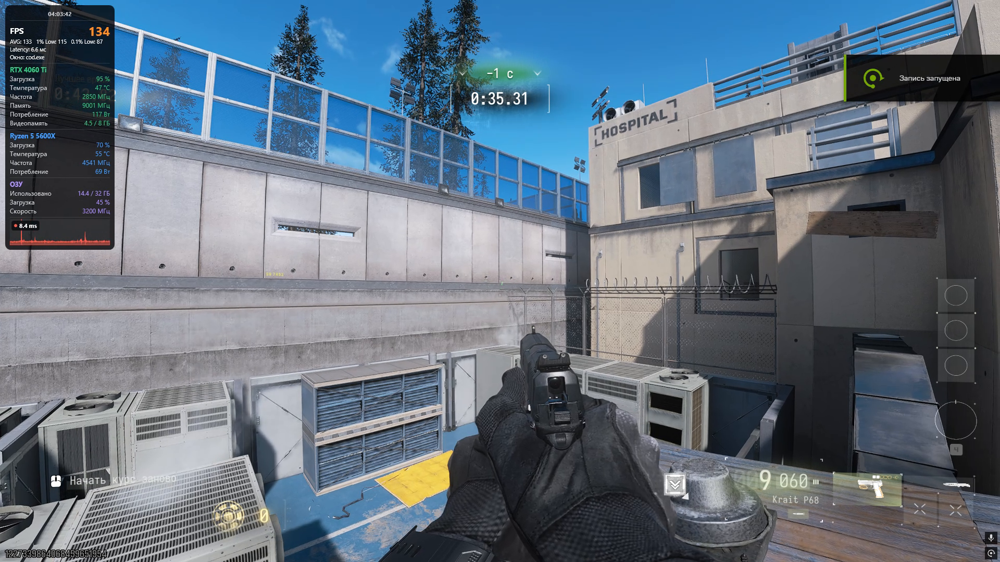
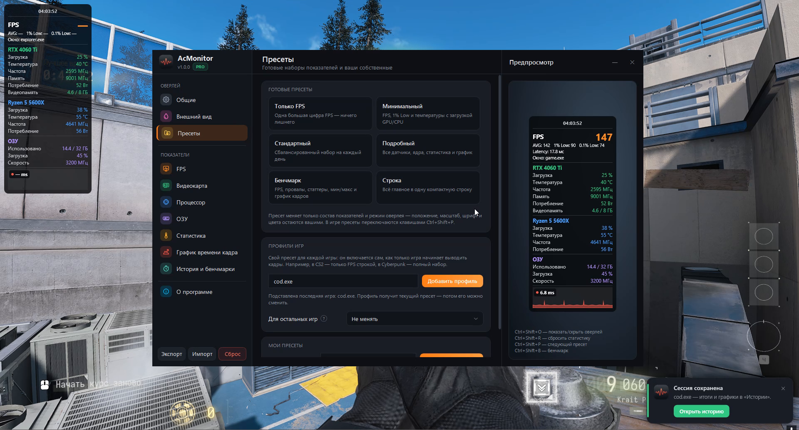
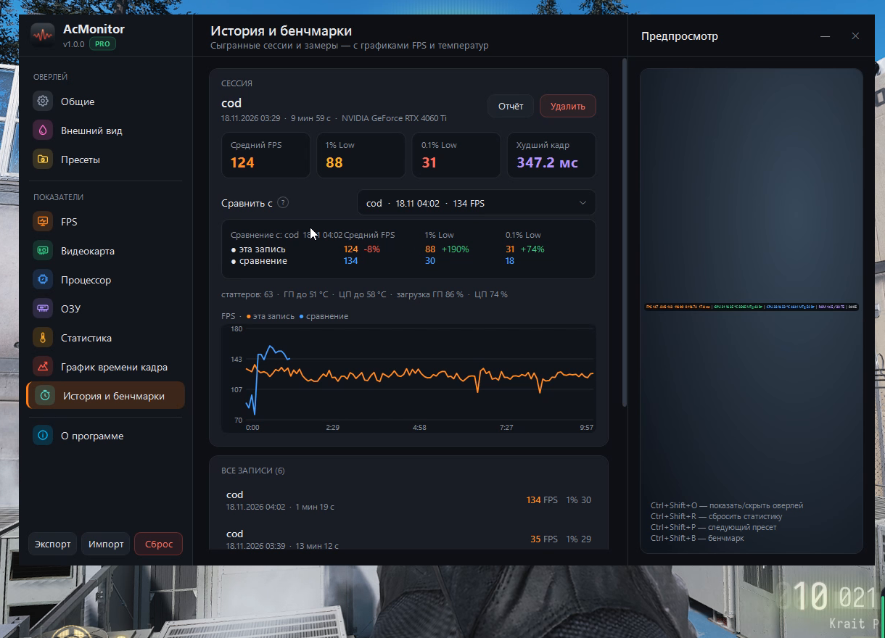

# AcMonitor

**FPS и датчики ПК прямо поверх игры**

AcMonitor показывает FPS, 1% Low, загрузку и температуры GPU/CPU в реальном времени.  
Программа **ничего не внедряет** в игру — античиты на неё не реагируют.

Бесплатно. Windows 10 и 11. Русский и английский интерфейс.

---

## Скриншоты

### Оверлей поверх игры

### Пресеты

### История и бенчмарки

---

## Что показывает оверлей

| Раздел | Данные |
|--------|--------|
| **FPS** | Текущий, средний, 1% и 0.1% Low, Reflex latency. При DLSS / FSR / XeSS — сколько кадров настоящих |
| **Видеокарта** | Загрузка, температура ядра и памяти, частоты, питание, вентиляторы, видеопамять |
| **Процессор** | Загрузка, температура (в т.ч. по CCD), частоты, питание |
| **Память** | Использование, частота, температуры модулей |
| **График кадров** | Время каждого кадра + детектор статтеров |

### Дополнительно
- Одноклавишный бенчмарк на 30 / 60 / 120 секунд с оценкой плавности
- История сессий с графиками FPS и температур, сравнение прогонов
- Цвет FPS по порогам и мигание при перегреве
- Готовые пресеты, компактный однострочный режим, горячие клавиши
- Обновления в один клик прямо из приложения

---

## Почему безопасно

FPS считается через события Windows (**ETW**), датчики читаются через **LibreHardwareMonitor**.  
AcMonitor **не инжектит код** в игру и не трогает её память — оверлей просто рисуется поверх окна.

---

## Free vs Pro

| Возможность | Free | Pro |
|-------------|------|-----|
| Все датчики, графики и статистика | ✅ | ✅ |
| Бенчмарк и последние 5 сессий в истории | ✅ | ✅ |
| Готовые пресеты и однострочный режим | ✅ | ✅ |
| Все цвета оверлея | ❌ | ✅ |
| Выбор шрифта | ❌ | ✅ |
| Свои пресеты | ❌ | ✅ |
| Профили на игру | ❌ | ✅ |
| Свои горячие клавиши | ❌ | ✅ |
| Скрытие оверлея от записи и стримов | ❌ | ✅ |
| Полная история без ограничений | ❌ | ✅ |
| Сравнение двух прогонов на одном графике | ❌ | ✅ |
| txt-отчёты и csv для Excel | ❌ | ✅ |

---

## Системные требования

- **ОС:** Windows 10 / 11 (64-bit)
- **Права:** Администратор (нужны для чтения датчиков)
- **Видеокарты:** NVIDIA, AMD, Intel
- **Процессоры:** Intel и AMD
- **.NET:** Не требуется (встроен)
- **Интернет:** Только для входа в Pro и обновлений

---

## Как установить

1. Скачай последнюю версию из [Releases](https://github.com/Accapura/AcMonitor/releases) или с [сайта](https://acmonitorpro.ru/)
2. Запусти установщик (нужны права администратора)
3. Запусти игру — оверлей появится поверх
4. Хочешь Pro → в приложении: **О программе → Войти через Telegram**

---

## FAQ

**Оверлей не видно в игре**  
1. Убедись, что оверлей включён (горячая клавиша или меню в трее).  
2. Переключи игру в режим **Borderless**.  
3. Перезапусти AcMonitor.

**Забанит ли античит?**  
AcMonitor ничего не внедряет в игру. Данные берутся из Windows и датчиков ПК. Античиты на такое не реагируют.

**Как перенести Pro на другой ПК?**  
Pro привязан к Telegram-аккаунту (до 3 ПК). На новом компьютере: AcMonitor → «О программе» → «Войти через Telegram».

---

## Ссылки

- 🌐 Сайт: [acmonitorpro.ru](https://acmonitorpro.ru/)
- 💬 Поддержка и покупка Pro: [@AcMonitorProBot](https://t.me/AcMonitorProBot)
- 📥 Скачать: [Releases](https://github.com/Accapura/AcMonitor/releases)

---

Сделано с ❤️ для тех, кто хочет видеть реальную производительность без риска бана.
