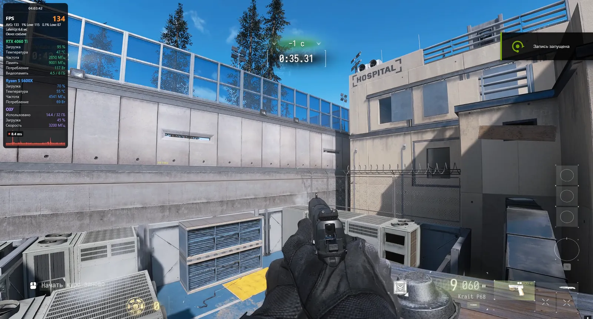
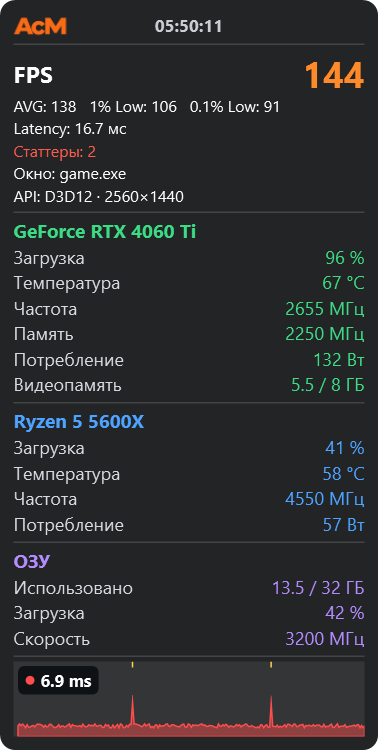
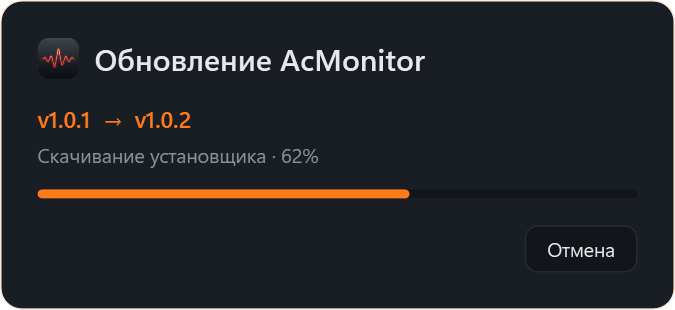

  
  <h1>AcMonitor</h1>
  
<strong>Игровой оверлей для Windows</strong> FPS, плавность кадров и датчики ПК в реальном времени

  

    
    &nbsp;
    
    &nbsp;
    
  

  
Windows 10 / 11 · x64 &nbsp;|&nbsp; <strong>Русский</strong> · <a href="README.en.md">English</a>

## Что показывает AcMonitor

| Раздел | Данные и инструменты |
| --- | --- |
| **FPS и плавность** | Текущий и средний FPS, 1% и 0.1% Low, график времени кадра и статтеры. |
| **Датчики ПК** | Загрузка, температуры, частоты, энергопотребление, ОЗУ и видеопамять. Набор показателей зависит от оборудования. |
| **Оверлей** | Стандартный вид, компактная строка, пресеты и предупреждения о перегреве. |
| **Бенчмарки и история** | Быстрый замер, отчёт по сессии и графики FPS и температур. |

FPS считывается из событий Windows (ETW). AcMonitor работает отдельным процессом и не внедряет код в игру.

## Скриншоты

  
  

Оверлей и окно обновления в AcMonitor 1.0.1. Показатели и ход загрузки демонстрационные.

## Установка

1. Скачай `AcMonitor_<версия>_Setup.exe` на [сайте](https://acmonitorpro.ru/download?lang=ru) или в [релизах GitHub](https://github.com/Accapura/AcMonitor/releases/latest).
2. Запусти установщик и пройди мастер. Для датчиков процессора оставь включённым **«Драйвер датчиков PawnIO»**, если мастер предлагает его установить.
3. Запусти игру. Нажми **Ctrl + Shift + O**, чтобы показать или скрыть оверлей, или **Ctrl + Shift + B**, чтобы запустить бенчмарк.

Установщик содержит .NET. SHA‑256 можно сверить на странице загрузки или в описании соответствующего релиза.

## Free и Pro

| Free | Pro |
| --- | --- |
| Оверлей, основные датчики, график времени кадра и бенчмарк. | Свои цвета, шрифт, пресеты и профили игр. В 1.0.1 можно настроить фото на фоне оверлея. |
| В приложении доступны последние пять сессий и пять бенчмарков. | Вся история, сравнение сессий, отчёты TXT и CSV и карточка результата для Discord. |
| Стандартные горячие клавиши. | Свои горячие клавиши и скрытие оверлея от записи в поддерживаемых сценариях. |

Тарифы доступны на [сайте AcMonitor](https://acmonitorpro.ru/tariffs?lang=ru). В 1.0.1 можно войти в профиль через браузер с Telegram, VK ID или Google и включить синхронизацию истории.

## Версии

| Версия | Основные изменения |
| --- | --- |
| **1.0.1** | Вход через браузер, синхронизация и удаление сессий в профиле, настройка фотофона Pro, знак AcM, обновлённый раздел «О программе» и проверка SHA‑256 в автообновлении. Добавлена поддержка коротких Pro‑ключей. |
| **1.0.0** | Первый выпуск с оверлеем FPS и датчиков, бенчмарками, историей, пресетами и Pro. |

[Полный список изменений](https://acmonitorpro.ru/changelog?lang=ru)

---

Разработка — **Accapura** · [Поддержка](https://acmonitorpro.ru/support?lang=ru) · [Discord](https://discord.com/users/256419758369538048)
